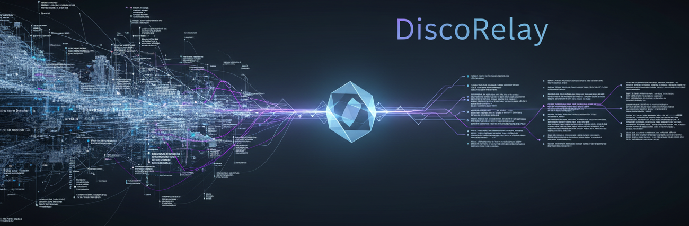

<p align="center">
  
</p>

<p align="right">
  
  
  
</p>

A self-hosted Discord notification hub. Every service in your homelab posts to **one** authenticated endpoint; DiscoRelay formats the event as a Notifiarr-style embed, routes it to the right channel, drops duplicates, survives Discord rate limits and outages, and keeps a delivery history in Postgres. No account, no cloud, no telemetry leaves your network.

## What it does

| | |
|---|---|
| **One endpoint per source** | `POST /webhook/<source>` with a dedicated parser (CrowdSec, DIUN, Backrest, Graylog, Uptime Kuma, Radarr…) |
| **Discord passthrough** | Apps with native Discord webhook support point at `/webhook/discord?route=<route>` instead of discord.com. Payload forwarded unchanged, but you still get auth, dedup, retries and history. |
| **Generic endpoint** | `POST /webhook/generic` with `{ title, message, severity, host, fields }` for scripts, cron jobs and playbooks. Slack-shaped `{ text }` works too. |
| **Notifiarr passthrough** | `POST /api/v1/notification/passthrough/<token>` (or `/webhook/notifiarr`) accepts the [Notifiarr passthrough schema](https://notifiarr.wiki/pages/integrations/passthrough/) unchanged: title, icon, description, fields, thumbnail, image, color, footer, pings. Scripts written for Notifiarr only change the host. `channels` in config maps a Notifiarr channel id to a route. |
| **GeoIP + map** | CrowdSec bans get Country / State / City / ISP / ASN from ip-api.com (free tier, cached, rate-limited) and an OpenStreetMap tile of the area. `GEOIP_ENABLED=false` turns it off. |
| **Fan-out** | `sources.<name>.forward: [urls]` copies the raw sender payload to extra consumers, so one DIUN webhook can feed both Discord and diun-dash. |
| **Routing** | Six channel routes: `critical`, `warning`, `daily`, `media`, `backups`, `updates`. Parsers pick a route by severity; you can override per source. |
| **Auth** | Every sender presents a token (`X-Relay-Token` header, `Authorization: Bearer`, or `?token=`). Tokens can be scoped to sources. |
| **Dedup** | Identical payloads from the same source are sent at most once per window (default 5 min, per-source override, `0` disables). |
| **Delivery** | Per-route queue, 10 s timeout, exponential backoff on 5xx/network, honours Discord `retry_after`, permanent failure on 4xx. Up to 10 embeds batched per message. |
| **History** | Every notification and every delivery attempt in Postgres (`/api/history`), pruned after `RETENTION_DAYS`. Optional: without `DATABASE_URL` the relay runs stateless. |
| **Observability** | `/health` (public) and Prometheus `/metrics` (token or `METRICS_PUBLIC=true`). Structured JSON logs. |

## Supported sources

| Source | Endpoint | Routes to |
|--------|----------|-----------|
| **Any Discord-capable app** | `/webhook/discord?route=<route>` | the route you name |
| **Anything else** | `/webhook/generic` | by `severity` (critical / error+warning / info) or explicit `route` |
| **Notifiarr-format scripts** | `/api/v1/notification/passthrough/<token>` | `?route=`, then `channels[ids.channel]`, else daily |
| CrowdSec | `/webhook/crowdsec` | warning |
| DIUN | `/webhook/diun` | updates |
| Graylog | `/webhook/graylog` | by event priority (3 → critical, 2 → warning, 1 → daily) |
| Backrest | `/webhook/backrest` | critical / warning / backups by status |
| Uptime Kuma | `/webhook/uptimekuma` | critical (down) / daily (up) |
| Grafana | `/webhook/grafana` | critical / warning by severity label |
| Home Assistant | `/webhook/homeassistant` | by severity |
| UnRAID | `/webhook/unraid` | by importance |
| UniFi | `/webhook/unifi` | by severity |
| Radarr / Sonarr / Lidarr | `/webhook/radarr` … | media |
| Tautulli | `/webhook/tautulli` | media (server events: critical) |
| check4updates | `/webhook/check4updates` | updates |

## Setup

```bash
git clone https://github.com/danktankk/DiscoRelay.git discorelay && cd discorelay
cp .env.example .env            # paste your six Discord webhook URLs, set RELAY_TOKEN and POSTGRES_PASSWORD
cp config.example.json config.json   # optional: per-source routes, dedup windows, icons
docker compose up -d --build
curl -s http://localhost:3080/health
curl -s -X POST -H "X-Relay-Token: $RELAY_TOKEN" http://localhost:3080/api/test/daily
```

Secrets live only in `.env` (gitignored). `config.json` holds no secrets and may be committed.

### Environment

| Variable | Purpose |
|---|---|
| `DISCORD_WEBHOOK_<ROUTE>` | Webhook URL per route (`CRITICAL`, `WARNING`, `DAILY`, `MEDIA`, `BACKUPS`, `UPDATES`). Add any new route the same way. |
| `RELAY_TOKEN` | Token with access to every source and the admin API (≥16 chars) |
| `RELAY_TOKENS` | Extra scoped tokens: `tok1:crowdsec\|backrest,tok2:*` |
| `RELAY_AUTH_REQUIRED` | `false` disables auth. Migration aid only; the log shouts about it. |
| `DATABASE_URL` | Postgres connection string; unset = no history |
| `RETENTION_DAYS` | History retention (default 90) |
| `DEDUP_WINDOW_SEC` | Default dedup window (default 300) |
| `METRICS_PUBLIC` | `true` exposes `/metrics` without a token |
| `GEOIP_ENABLED` | `false` disables ip-api.com lookups and the map tile on CrowdSec bans |
| `LOG_LEVEL` | `debug` / `info` / `warn` / `error` |

### Per-source config (`config.json → sources.<name>`)

- `route` — fixed route, or `auto` to let the parser decide by severity
- `dedup_window_sec` — override the global window (`0` = never suppress, e.g. media events)
- `icon`, `color` — embed cosmetics used by the parser

## Pointing senders at the hub

Replace `HUB` with the relay's address and `TOKEN` with your relay token.

| Sender | Where | Value |
|---|---|---|
| DIUN | `DIUN_NOTIF_WEBHOOK_ENDPOINT` | `http://HUB:3080/webhook/diun?token=TOKEN` (remove the `DIUN_NOTIF_DISCORD_*` vars). Keep a dashboard fed with `sources.diun.forward: ["http://diun-dash:8554/webhook"]`. |
| CrowdSec | `notifications/discorelay.yaml` (`type: http`) | `url: http://HUB:3080/webhook/crowdsec` + `headers: { X-Relay-Token: TOKEN }` |
| Backrest | hook `actionCommand` | `curl -s -X POST http://HUB:3080/webhook/backrest -H "X-Relay-Token: TOKEN" …` |
| Graylog | Alerts → Notifications → HTTP Notification | URL `http://HUB:3080/webhook/graylog?token=TOKEN` |
| Uptime Kuma | Notification → Webhook | URL `http://HUB:3080/webhook/uptimekuma`, additional header `X-Relay-Token: TOKEN` |
| Shrike, Gitea, Authelia, anything with a Discord webhook field | the Discord webhook URL field | `http://HUB:3080/webhook/discord?route=updates&token=TOKEN` |
| Scripts / Ansible / cron | `curl` | `curl -s -X POST http://HUB:3080/webhook/generic -H "X-Relay-Token: TOKEN" -H "Content-Type: application/json" -d '{"title":"Disk 91%","message":"/var on pve1","severity":"warning","host":"pve1","source":"disk-check"}'` |

## API

| Method | Path | Auth | Purpose |
|---|---|---|---|
| `POST` | `/webhook/:source` | token scoped to source | ingest; returns `202 { ok, queued, suppressed, dropped, ids }` |
| `GET` | `/health` | none | status, loaded sources, routes, queue depth, DB health |
| `GET` | `/metrics` | token (`metrics` scope) unless public | Prometheus text format |
| `GET` | `/api/history?limit=&source=&status=&route=` | token (`admin` scope) | recent notifications from Postgres |
| `POST` | `/api/test/:route` | token (`admin` scope) | send a test embed to a route |

Metrics: `discorelay_received_total{source}`, `discorelay_sent_total{route}`, `discorelay_failed_total{route,reason}`, `discorelay_suppressed_total{source}`, `discorelay_rejected_total{reason}`, `discorelay_attempts_total{route,outcome}`, `discorelay_queue_depth{route}`.

## Embed style

Embeds follow the [Notifiarr](https://github.com/Notifiarr) convention: author line with service icon and event label, a title naming the subject, inline field triplets, code blocks for release names and GeoIP, colour by event type, Eastern Time footer.

## Adding a source

Drop `src/parsers/<name>.js` exporting `parse(body, config, ctx)`. Return either an array of embeds (each may set `route`) or `{ payloads: [{ route, body }] }` where `body` is a complete Discord webhook body. `ctx` carries `{ source, query, headers, ip }`. Add a test in `test/parsers.test.js`, run `npm test`, rebuild.

## Development

```bash
npm install
npm test          # node:test, no network, fake Discord server
```

## Upgrading from 1.x

- Auth is now required. Set `RELAY_TOKEN` and add the token to every sender (header or `?token=`), or set `RELAY_AUTH_REQUIRED=false` while you migrate.
- Webhook URLs move from `config.json` to `.env` (`DISCORD_WEBHOOK_*`). Values left in `config.json` still work.
- Response changed from `{ ok, sent }` to `202 { ok, queued, suppressed, dropped, ids }`; delivery is asynchronous.
- Postgres is optional but recommended (`docker-compose.yml` ships one).
